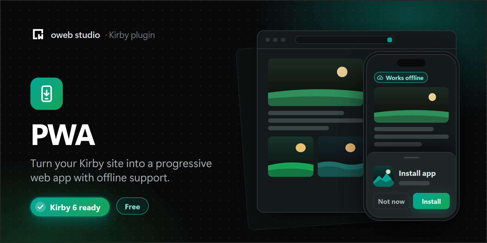

# Kirby PWA

Turns your Kirby site into a progressive web app: a web app manifest, a service worker that keeps your site usable offline, and helpers for an install button and update notices.

## What is a PWA (progressive web app)?

Progressive web apps are web apps that use service workers, manifests and other web platform features to give users an experience on par with native apps. They can be installed, work offline or on bad connections, and can be launched from the home screen like any other app.

For details:

- https://web.dev/progressive-web-apps/
- https://developer.mozilla.org/en-US/docs/Web/Progressive_web_apps

## Requirements

- Kirby 5 or 6
- PHP 8.2 or newer (Kirby 6 needs PHP 8.3)
- HTTPS. Browsers only register service workers on secure origins (`localhost` counts as secure for development).

For Kirby 3.6 to 4, use version 1.x of this plugin.

## Installation

1. Download the latest release
2. Unzip downloaded file
3. Copy/paste unzipped folder in your `/site/plugins` folder

Or with Composer:

```
composer require owebstudio/kirby-pwa
```

## Usage

Add the snippet to the `<head>` of every page:

```php
<?php snippet('pwa') ?>
```

And enable the plugin in your `config.php`:

```php
<?php

return [
    'owebstudio.pwa' => [
        'enable' => true,
        'manifest' => [
            'name' => 'My Site',
            'short_name' => 'Site',
            'description' => 'News and notes from my site',
            'background_color' => '#ffffff',
            'theme_color' => '#000000',
            'display' => 'standalone'
        ],
        'icons' => [
            '192x192' => 'assets/icons/icon-192x192.png',
            '512x512' => 'assets/icons/icon-512x512.png',
            '1024x1024' => [
                'path' => 'assets/icons/icon-maskable.png',
                'purpose' => 'maskable'
            ]
        ]
    ]
];
```

That's all you need for an installable site that works offline.

## How caching works

The plugin serves a service worker at `/serviceworker.js`. It handles requests like this:

| Request | Strategy |
|:--- |:--- |
| Pages | Network first. When the network fails, the page comes from the cache, and pages that were never visited show the offline page. |
| Files in `media/pages`, `media/site` and `media/users` | Cache first. Kirby changes these URLs whenever a file changes. |
| Other images, scripts, styles and fonts of your site | Stale while revalidate: the cached copy is used right away and updated in the background. |
| Everything else | Network only, the service worker doesn't touch it |

The service worker never handles the Panel, the API, `media/panel`, requests from Panel views, requests other than `GET`, requests to other domains, previews of drafts and changes, and range requests (audio and video). Responses with `Cache-Control: no-store` are never cached. Kirby sends this header for pages that depend on the logged-in user.

On install, the service worker caches the offline page, the `start_url` of the manifest and the URLs in the `precache` option.

Every change of the plugin, its options or the offline page creates a new version of the service worker. It replaces the old one on the next visit and removes its caches. You can also set the `version` option to force a new version, for example after you changed your CSS.

## Offline page

When a page is neither online nor in the cache, the service worker shows the offline page.

- If your site has a page with the ID `offline` (or the ID in the `offline` option), that page is used. You can edit it in the Panel like any other page; unlisted is fine.
- Otherwise the plugin shows a simple page at `/pwa/offline`. You can replace it with your own `site/snippets/pwa/offline.php`.

The offline page is cached on install, but the files it links to are only cached when they are used somewhere else. Add them to the `precache` option if the offline page needs them.

## Install button

Browsers that support it show their own install prompt. If you want an install button in your layout instead, add:

```php
<?php snippet('pwa/install') ?>
```

It renders a `<button class="pwa-install">`, which is hidden until the browser allows the installation. On iOS, which has no install prompt, it shows a short hint how to add the site to the home screen instead. All texts can be changed:

```php
<?php snippet('pwa/install', [
    'label' => 'Get the app',
    'hint' => false, // no hint on iOS
    'class' => 'button'
]) ?>
```

The button uses the `hidden` attribute. Make sure your CSS doesn't override it with a `display` value.

## Update notice

```php
<?php snippet('pwa/update') ?>
```

Shows a notice with a reload button when a new version of the service worker takes over an open page. Change the texts with the `text`, `reload` and `class` variables.

## JavaScript

The `pwa` snippet adds a small `window.kirbyPwa` object and fires events on `window`, so you can build your own install and update UI:

| | |
|:--- |:--- |
| `pwa:installable` | The browser allows the installation |
| `pwa:installed` | The site was installed |
| `pwa:update` | A new service worker took over this page |
| `kirbyPwa.install()` | Shows the install prompt. Returns a promise with `accepted`, `dismissed` or `unavailable`. |
| `kirbyPwa.installPrompt` | The install prompt event, or `null` |
| `kirbyPwa.registration` | The service worker registration |

The inline scripts use Kirby's nonce (`$kirby->nonce()`), so they work with a Content Security Policy.

## Translations

The texts of the offline page, the install button and the update notice are translated into English, German and Turkish. On multi-language sites, add the keys from `translations/en.php` to your language files to change them or add other languages.

## Options

All options are set in `config.php` with the `owebstudio.pwa.` prefix.

| Option | Type | Default | Description |
|:--- |:--- |:--- |:--- |
| enable | boolean | `false` | Enables the manifest, the service worker and the snippet |
| manifest | array | `[]` | Members of the web app manifest, see below |
| icons | array | `[]` | App icons, keyed by size. A path, or an array with `path`, `purpose` and `type`. |
| splash | array | `[]` | Startup images for iOS, keyed by size. A path, or an array with `path` and `media`. |
| shortcuts | array | `[]` | Shortcuts with `name`, `url`, and optional `short_name`, `description` and `icons`. Names can be translation arrays. |
| custom | array | `[]` | Additional members of the manifest, e.g. `categories` or `screenshots` |
| offline | string&#124;false | `'offline'` | ID of the offline page, `false` disables the offline page |
| precache | array | `[]` | Page IDs, paths or URLs that are cached on install |
| exclude | array | `[]` | Paths that the service worker never handles, e.g. `['cart', 'shop/*/checkout']`. A path also matches the pages below it. |
| strategies | array | `[]` | Strategies for paths, e.g. `['blog/*' => 'stale-while-revalidate']`. One of `network-first`, `cache-first`, `stale-while-revalidate` and `network-only`. |
| limits | array | `['pages' => 50, 'assets' => 200]` | Maximum number of cached pages and files. The oldest entries are removed first. |
| version | string&#124;null | `null` | Change it to force a new service worker |
| manifest.json | string&#124;closure&#124;null | `null` | Your own manifest: the path to a file (absolute or relative to the site root) or a closure that returns the response |
| serviceworker.js | string&#124;closure&#124;null | `null` | Your own service worker: the path to a file or a closure |

The `manifest` option accepts these members:

| Member | Default |
|:--- |:--- |
| name | Title of the site |
| short_name | `name` |
| description | none |
| id | none |
| lang, dir | Language of a multi-language site |
| start_url | `'.'` (the site root) |
| scope | `'.'` (the site root) |
| display | `'standalone'` |
| orientation | `'any'` |
| theme_color | `'#000000'` |
| background_color | `'#ffffff'` |
| status_bar | `'black'`, only used for the iOS status bar (`default`, `black` or `black-translucent`) |

## Upgrading from 1.x

- Kirby 5 and PHP 8.2 are required.
- The service worker now caches pages and files and has an offline page. Check the `exclude` option if parts of your site must always come from the network, like a cart or a checkout.
- The global functions `optionsKirbyPwa()`, `snippetKirbyPwa()` and `getArrayLastItem()` were removed. Use `snippet('pwa')`.
- The manifest no longer contains the non-standard `splash` and `status_bar` members. Both options still work for iOS.
- `name` defaults to the title of the site instead of "Kirby PWA", and `description` is left out unless you set it.
- The Windows 8 tile tags (`msapplication-*`) are gone.

## License

MIT
